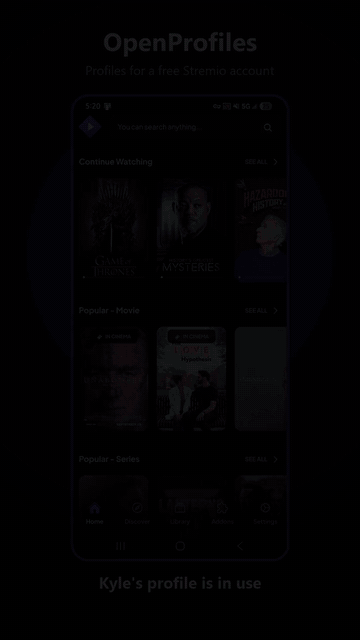
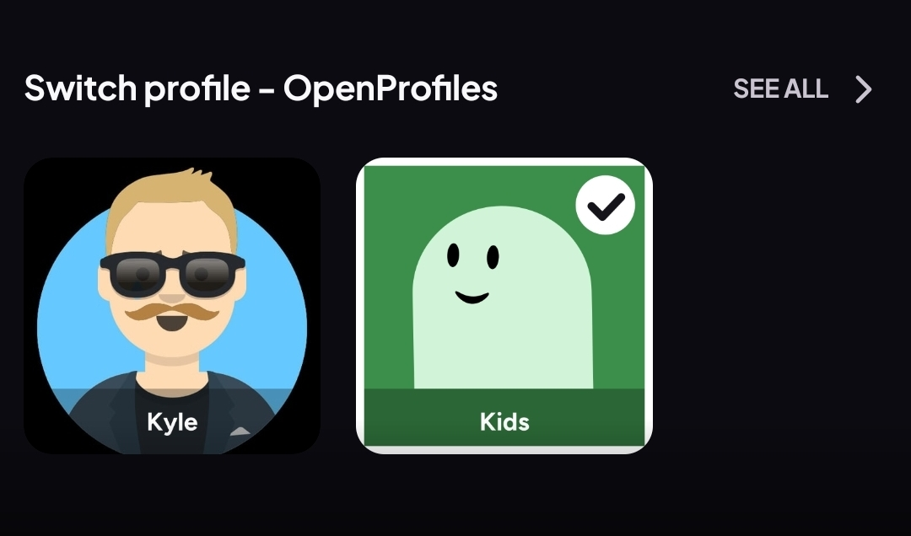
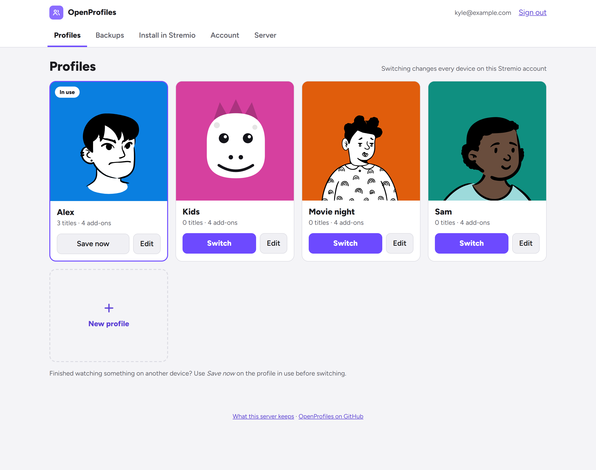
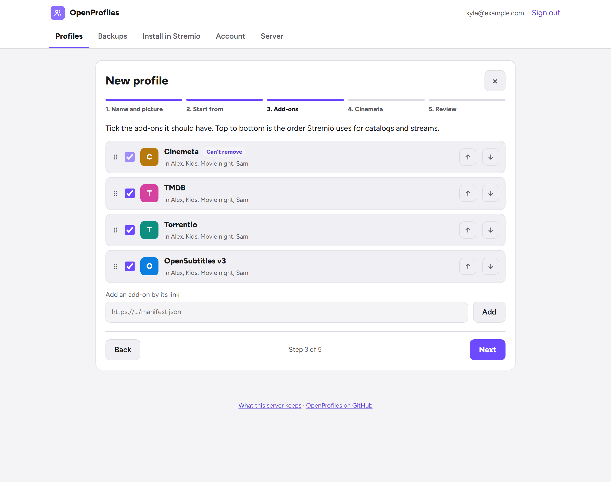
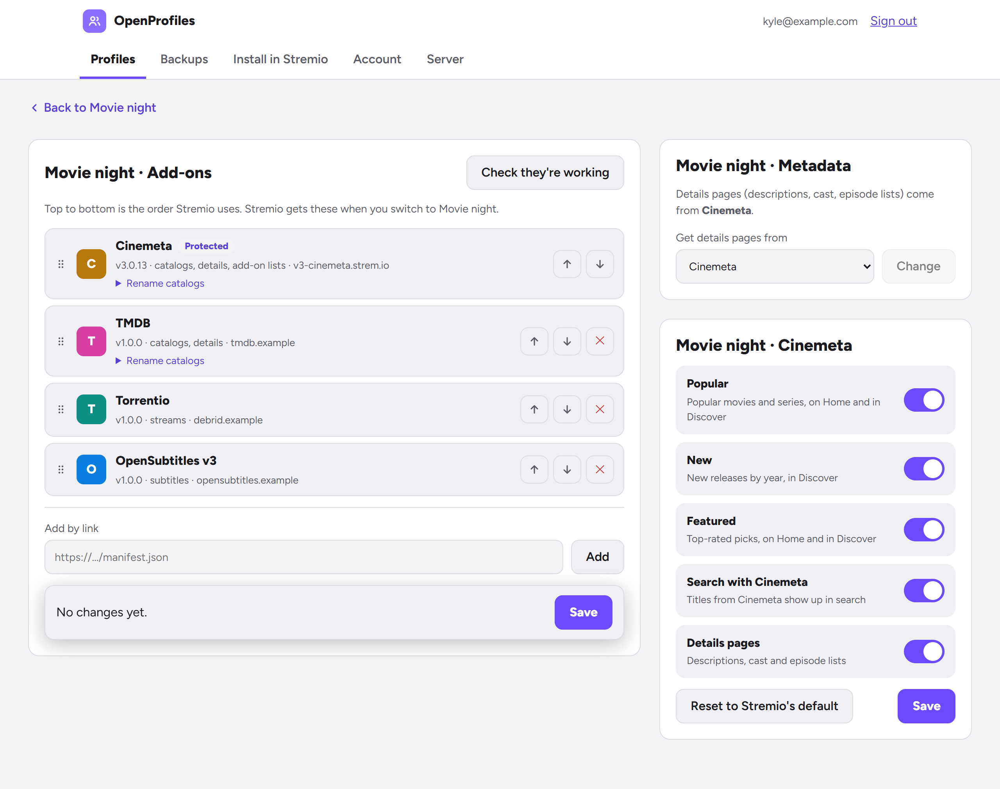

# OpenProfiles

Profiles for a free Stremio account. Each profile keeps its own library, Continue Watching,
add-ons and new-episode notifications. Switch from a web page, or from a **Switch profile** row
right on Stremio's Home screen.

OpenProfiles is a small server you run yourself (one Docker container). It is not made by or
affiliated with Stremio. To try it first, there's a free shared server at
[openprofiles.kgenovz.com](https://openprofiles.kgenovz.com) (limited places); its
[privacy page](https://openprofiles.kgenovz.com/privacy) says what it keeps. Running your own is
recommended: it's light, and then your add-on links never leave your hands.

<p align="center">
  
</p>

> **Have Stremio Supporter?** Use Stremio's own profiles instead. They work on several devices
> at the same time; OpenProfiles can't.

**Tested on** Stremio for Windows, Android phones and Android TV. Not tested yet: macOS and
Linux desktop, the web app and iOS. If you try one, an issue saying how it went helps.

## How it works

Stremio keeps one library and one add-on list per account. OpenProfiles saves a copy of them for
each profile. When you switch, it:

1. saves the account as it is now into the profile you're leaving (and takes a backup),
2. writes the profile you picked into the account: library, add-ons and notifications.





Things to know:

- **Switching changes every device signed in to the account.** Everyone sees the same profile.
- **Each profile has its own add-ons**, and its own Cinemeta catalogs (see below).
- **Refreshing after a switch:** in the Switch profile row, tap the profile's stream
  ("Tap here to refresh Stremio"). Stremio reloads and lands on Home on desktop (after a quick
  hop through the browser), or on your Library on Android phones and Android TV (then go back
  Home). After switching from the web page, just click back into the Stremio window. Apps
  where that doesn't work (older ones) need a close and reopen.
- **Someone still watching on another device during a switch keeps their progress.** Stremio
  saves the title they're playing back into the account as it goes, so for a while it shows in
  the new profile's Continue Watching too. About 10 minutes after they stop, OpenProfiles moves
  that progress to the profile that was watching and takes the title back out of the new one.
  Episodes marked watched on that device after the switch may need marking again. See the
  known limitation below for when it can't tell who was watching.
- **Opening a profile in the Switch profile row switches to it.** Stremio asks for the profile's
  "stream" as soon as its page opens, and that request is the switch. A profile with a
  [passcode](#passcodes) asks for it first.

### Known limitation: watching during a switch

OpenProfiles can't see who is holding the remote. It decides who is watching from the
positions Stremio saves, and when that isn't clear-cut, the profile in use keeps the title. The
rules never take someone's own viewing away, but they do allow a little crossover:

- **A title started just before a switch** may not be known to Stremio yet. It shows in the
  new profile's Continue Watching for a few minutes, until OpenProfiles spots it (about 4 minutes
  after the switch) and moves it back once playback stops. One started only a few seconds
  before the switch can't be told from the new profile starting it, so it stays there.
- **When both profiles watch the same title around a switch** (the same movie, or the same
  show at nearby episodes), OpenProfiles can't tell the two apart. The profile in use keeps it,
  and the other profile may miss some progress there.
- **A device clock that's well off**, or skipping far ahead in a title the other profile had
  only just started, can make one profile's viewing look like the other's, so it ends up in the
  other profile.

This is the accepted behaviour for now. Usually the worst case is a title sitting in the wrong
Continue Watching for a few minutes, or a profile missing some progress. Nothing is ever
deleted: at worst it ends up in the other profile. Switching while nothing is playing avoids
all of it.

### Known limitation: stray "new episode" cards

Stremio keeps its new-episode alerts (the "+3" badges) on each device and rebuilds them only
every 6 hours. Continue Watching shows any show with alerts, even one that isn't in the current
profile. So for up to 6 hours after a switch, the previous profile's shows with new episodes can
appear in Continue Watching. Dismiss the card to remove it, or wait. Likewise, the new profile's
own new-episode badges appear at the next rebuild. This happens inside the Stremio app; an
add-on can't trigger the rebuild.

## Set up

You need a server with Docker and a domain name with https. Stremio only installs add-ons over
https.

1. Copy [`docker-compose.yml`](docker-compose.yml) and set:

   | Variable | Required | What it is |
   |---|---|---|
   | `PUBLIC_URL` | yes | The https address OpenProfiles is reached at, e.g. `https://profiles.example.com` |
   | `ACCESS` | no | Who can sign in. `owner` (default): the first Stremio account to sign in owns the server. `list`: only `ALLOWED_ACCOUNTS`. `open`: anyone (a shared instance) |
   | `ALLOWED_ACCOUNTS` | with `list` | Stremio emails or user ids, comma-separated |
   | `MAX_ACCOUNTS` | no | With `open`, the most accounts the server takes |
   | `REMOVE_UNUSED_DAYS` | no | With `open`, accounts nobody uses for this many days are removed, so they don't hold places forever (default `90`; `0` never; otherwise 30 to 3650). Used means signed in, visited the pages, or Stremio asked its add-on for anything. Only days the server was running count, at most 5 go a day, and the owner, `ADMINS` and an account with an unfinished switch are never removed |
   | `LOG_LEVEL` | no | `error`, `warn`, `info` (default) or `debug` |
   | `SECRET_KEY` | no | 32-byte key (64 hex chars) instead of the generated `/data/secret.key` |
   | `PORT` | no | Port inside the container (default `7000`) |
   | `TRUST_PROXY` | no | Express trust-proxy setting (default trusts local and private networks) |
   | `ALLOW_PRIVATE_ADDONS` | no | `true` lets the add-on manager fetch add-ons on private networks (a home LAN). Off by default |
   | `OPERATOR` | no | On a shared server (`list` or `open`), who runs it; shown on the sign-in and privacy pages |
   | `PRIVACY_NOTE` | no | One more line for the privacy page about your setup, e.g. `The web proxy keeps no access logs.` |
   | `ADMINS` | no | Stremio user ids (or emails) that may use the **Server** tab besides the owner (the first account to sign in). Ids are safer: an email can be changed, and whoever gets the address later would run the server |

   `ACCESS`, `ALLOWED_ACCOUNTS`, `MAX_ACCOUNTS`, `REMOVE_UNUSED_DAYS`, `LOG_LEVEL`, `OPERATOR`
   and `PRIVACY_NOTE` are starting values: the **Server** tab can change each of them later without a restart (see
   [Running the server](#running-the-server)).

2. Put it behind a reverse proxy that handles https. With [Caddy](https://caddyserver.com):

   ```
   profiles.example.com {
       reverse_proxy 127.0.0.1:7000
   }
   ```

   If Caddy runs in Docker too, put both containers on one Docker network and use
   `reverse_proxy openprofiles:7000`.

3. `docker compose up -d` and open `https://profiles.example.com`.
4. **Sign in with your Stremio email and password.** There's no separate password: your
   Stremio account is your OpenProfiles account. The password is sent to Stremio once to get a
   sign-in key and is never stored. The first time, your account as it is now becomes the
   **Original** profile, and a permanent backup of it is kept. With the default `ACCESS=owner`,
   do this right away: the first account to sign in owns the server.
5. **New profile** opens a short wizard: name, picture and colour; what it starts with (an empty
   library, a copy of the account, or a copy of another profile); which add-ons it has and in what
   order; and which Cinemeta catalogs it shows. Nothing in Stremio changes until you switch to it.
   A photo of your own can be added afterwards, from the profile's **Edit › Picture**.

   
6. On the **Install in Stremio** tab, choose **Install in Stremio**.

One server can hold several Stremio accounts (`ACCESS=list` or `open`). Each account only ever
sees and changes its own profiles, backups and Stremio account.

### Where to run it

For a household it needs very little: tens of MB of memory and a few MB of disk per Stremio
account. The image is built for `amd64` and `arm64`. What it does need:

- an **https** address Stremio can reach from every device, and
- a **disk that persists** (`/data`), on a machine that stays up: the add-on answers Stremio
  whenever someone opens a profile.

So a small always-on VM (the free tiers of the big clouds' smallest VMs are enough), a home
server, NAS or Raspberry Pi, or a VPS you already have all work. At home, a tunnel such as
Cloudflare Tunnel or Tailscale Funnel gives it an https address without opening ports. Hosting
that sleeps when idle or wipes its disk on restart doesn't suit it.

### Back up the data volume

`/data` holds the database **and** `secret.key`. Everything stored is encrypted with that key
(add-on links often contain debrid keys, and libraries are watch history). Without the key, the
saved profiles and backups can't be read. Back up the whole volume.

The database is in use while the server runs, so back up the nightly copies in
`/data/snapshots` (consistent at any time) together with the key, for example:

```bash
docker compose cp openprofiles:/data ./openprofiles-backup
```

To restore, start the container on an empty `/data` that holds `secret.key` and one of those
copies renamed to `openprofiles.db`, owned by the container's user (uid 1000). OpenProfiles
checks the key against the data when it starts and refuses a mismatch.

### Updating

```bash
docker compose pull && docker compose up -d
```

The example compose file follows `1`, so this brings every 1.x release (new features and
fixes). A 2.0 would need changes by hand, and would only come with a new tag. Database changes are applied on start, and each release says in
[CHANGELOG.md](CHANGELOG.md) if anything needs doing by hand.

## Running the server

Whoever signed in first owns the server and gets a **Server** tab (so do any `ADMINS`). Nobody
else sees it, and it only ever shows counts: nothing on it names or picks out an account.
The owner is that Stremio account: if they delete their OpenProfiles account, nobody else
takes over, and signing in again makes them the owner again. List `ADMINS` by Stremio user id
where you can; emails work too, but an email can change hands.

- **Overview:** accounts (of the limit, new this week, used this week, with the add-on
  installed, unused for 60 days), switches per day this week and any that didn't finish, the
  daily jobs' last run, the database copies, memory, database size and free disk, and the
  errors and warnings since the server started, grouped by message (details stay in the log).
- **Who can sign in:** the access rule, the list, the account limit and how long an unused
  account is kept. The owner can always sign in, whatever the rule, so a list without them
  can't lock them out.
- **Look:** the server's name, accent colour, logo (PNG, JPG or WebP; it is redrawn as a
  256 px PNG, so nothing else in the file is kept) and light, dark or automatic appearance.
- **Sign-in page, announcement, about:** the headline and introduction, a notice shown at the
  top of every page, who runs it, a contact link, the privacy note, and whether the pages link
  to OpenProfiles on GitHub.
- **In Stremio:** the add-on's name and description and the Home row's name. Installed copies
  pick them up at their next switch.
- **Server log:** how much it writes.

A value saved there overrides its environment variable, and the tab says so ("Overrides .env")
with a way back to the `.env` value. `PUBLIC_URL`, `SECRET_KEY`, `TRUST_PROXY`,
`STREMIO_API_URL`, `ALLOW_PRIVATE_ADDONS`, `PORT` and `DATA_DIR` stay in the environment only:
they decide where the server lives and what it trusts.

## Backups and recovery

- A backup is taken automatically every day (only when something changed; the last 14 are
  kept), and before every switch, restore and edit. You can also make one yourself, restore any
  backup (with a preview first), or download it as JSON. Downloads contain your add-on links:
  keep them private.
- The backup made at setup is kept forever.
- Deleted profiles go to a **bin** for 30 days, so they can be brought back.
- **Download everything** puts every profile and backup in one file, optionally locked with a
  passphrase, and **Bring back from a file** restores it (on this server or a new one).
- Every night the server also keeps a full copy of its database in `/data/snapshots`
  (7 daily + 4 weekly). Those copies are encrypted too, so keep `secret.key` with them.
- If `secret.key` doesn't match the data, OpenProfiles refuses to start and says so, rather
  than writing anything the rest of the data couldn't be read with.
- If a switch stops partway (Stremio went down, the server restarted), the page shows
  **A switch didn't finish** with two choices: finish switching, or go back to how things were.
  Nothing else can change until you pick one.

## Add-ons and Cinemeta, per profile

Each profile has its own add-on list. Open a profile's **Edit**, then **Manage add-ons**, to:

- reorder (drag, or the arrows: top to bottom is the order Stremio uses), remove, and rename
  catalogs,
- add an add-on by its link, or one another profile has,
- check that each add-on still answers.



Cinemeta and Local Files are Stremio's protected add-ons: they can be moved but not removed.
OpenProfiles itself stays in every list, so the Switch profile row never disappears.

**Cinemeta** (Stremio's built-in catalogs) can be trimmed per profile: hide Popular, New or
Featured, turn its search off, or turn off its details pages (only sensible when another add-on,
like TMDB, provides them; the page warns otherwise). This edits the copy of Cinemeta stored in
that profile's add-on list, the same way Stremio stores it. Bringing a hidden catalog back
fetches Cinemeta again; if Cinemeta can't be reached, nothing changes. **Reset to Stremio's
default** puts the stock Cinemeta back.

Keep Cinemeta in every profile, even one that gets its catalogs and details pages elsewhere
(a ratings wrapper, TMDB, AIOMetadata). Stremio's Calendar and new-episode notifications only
come from Cinemeta's own add-on (its "Calendar videos" and "Last videos" catalogs, which
OpenProfiles never hides); a wrapped copy doesn't count. A profile without it gets a warning and
an **Add Cinemeta** button, which adds it as a shell (rows, search and details off) when another
add-on already provides those.

Details pages come from the first add-on in the list that gives them. The **Metadata** card on a
profile's add-on page shows which one that is and lets you pick another: it moves to the top,
and Cinemeta's own details pages turn off (or back on, if you pick Cinemeta). Add-ons that use
their own ids, like TMDB set to TMDB ids, can be picked for profiles that run on those ids alone.

Editing the profile in use changes Stremio right away; editing any other profile changes only
its saved copy, which Stremio gets when you switch to it. Either way a backup is taken first,
and the page offers **Undo** for 24 hours. Undo puts back only the add-ons: anything watched
since stays.

Add-on links are fetched by the server, so they are checked first: only `http(s)`, no private
or local addresses (unless `ALLOW_PRIVATE_ADDONS`), at most 512 KB, 5 seconds. The page never
shows the links themselves, since they often contain debrid keys.

## Import from StremShare

In StremShare, open **Tools › Backup & restore** and download a backup. In OpenProfiles, choose
the file under **Import from StremShare**. It's saved as a backup and, if you like, as a new
profile. Nothing changes in Stremio until you switch to that profile or restore the backup.
Both StremShare export formats are read (`format: "stremshare-account-backup"` v1, and the
older `schemaVersion: 1` files). A file from a different Stremio account needs an extra
confirmation.

## Passcodes

Any profile can have a 4-digit passcode: **Edit › Passcode**. Switching to it then asks for the
code, on the web page and in Stremio. Opening a locked profile in the Switch profile row doesn't
switch; it offers **Unlock**, which opens a page in the browser to enter the code (that switches,
then goes back to Stremio), and **Refresh**.

- **On a TV** (or anything without a browser): unlock the profile on your phone, from its Switch
  profile row or the OpenProfiles web page, then press **Refresh** on the TV.
- An unlock is good for one switch: switching away and back asks again. Switching away from a
  locked profile never asks.
- Changing or removing a passcode needs the current one. Forgot it? Signing in again with the
  Stremio password lets you set a new one without it, for 10 minutes.
- After 5 wrong codes in a row (counted per account, on every page), codes are refused for 15
  minutes.
- It keeps the kids out; it isn't real security. Anyone with the Stremio password can get around
  it. Only a salted hash of the code is kept, and it goes into "Download everything".

## Profile pictures

Each profile has a colour and a picture: its first letter, one of eleven hand-drawn characters,
or a generated face. Generated faces come from [DiceBear](https://www.dicebear.com) styles that
are public domain (CC0): Lorelei, Notionists, Open Peeps, Pixel Art and Thumbs.

A profile can also have one photo of its own: **Edit › Picture › Photo › Upload a photo**. The
browser shrinks it first, and the server redraws it as a 512 px square JPEG (PNG, JPG and WebP
are read; nothing else from the file is kept). It's stored encrypted with the profile, fills
the profile's tile in Stremio, and goes into "Download everything".

## Security notes

- The add-on link contains a secret token, because opening a profile in Stremio switches the
  account. Treat the link like a password. **Get a new link** on the **Install in Stremio** tab
  replaces it (and updates the copy installed in Stremio).
- The web page uses a session cookie (`HttpOnly`, `SameSite=Strict`), CSRF tokens on every
  form, and sign-in rate limits per address and per email. Each account can start at most 60
  trips to Stremio in 10 minutes, so one account looping pages can't get the server throttled
  by Stremio for everyone.
- Sign-ins are only accepted from the server's own sign-in page (checked with the browser's
  `Sec-Fetch-Site`, else `Origin`), so another site can't sign your browser into its account.
  Pages send no referrer to other sites (`Referrer-Policy: same-origin`).
- Uploaded pictures (the server logo, profile photos) are decoded and drawn again as plain
  PNG/JPEG before they're kept; SVGs and anything that isn't a PNG, JPG or WebP are refused.
- Each Stremio account on a server only ever sees and changes its own profiles and backups.
- The server log never records emails, IP addresses, add-on links or watch history; add-on
  tokens in request paths are masked. `/privacy` lists everything that is kept.
- The **Server** tab answers "not found" to everyone but the owner (and `ADMINS`), and settings
  that could redirect sign-ins or reach private networks can't be changed from it.

## Development

Needs Node 22+.

```bash
npm install
npm test          # unit and integration tests against a fake Stremio API
npm run lint
```

To try the web page without a real account, run the fake Stremio API and point OpenProfiles at
it (sign in to the fake with `kyle@example.com` / `hunter22`):

```bash
node scripts/dev-stremio.js
```

```bash
PUBLIC_URL=http://localhost:7000 DATA_DIR=./data-dev \
  STREMIO_API_URL=http://localhost:7001 npm run dev
```

`scripts/render-art-preview.js` writes sample posters for a visual check.

Design notes and decisions live in [PLAN.md](PLAN.md).

## Credits

- [Figtree](https://github.com/erikdkennedy/figtree) by Erik Kennedy (SIL Open Font License),
  via Fontsource.
- [DiceBear](https://www.dicebear.com) (MIT), with CC0 styles by Lisa Wischofsky (Lorelei),
  Zoish (Notionists), Pablo Stanley (Open Peeps) and DiceBear (Pixel Art, Thumbs).

## License

[MIT](LICENSE)
